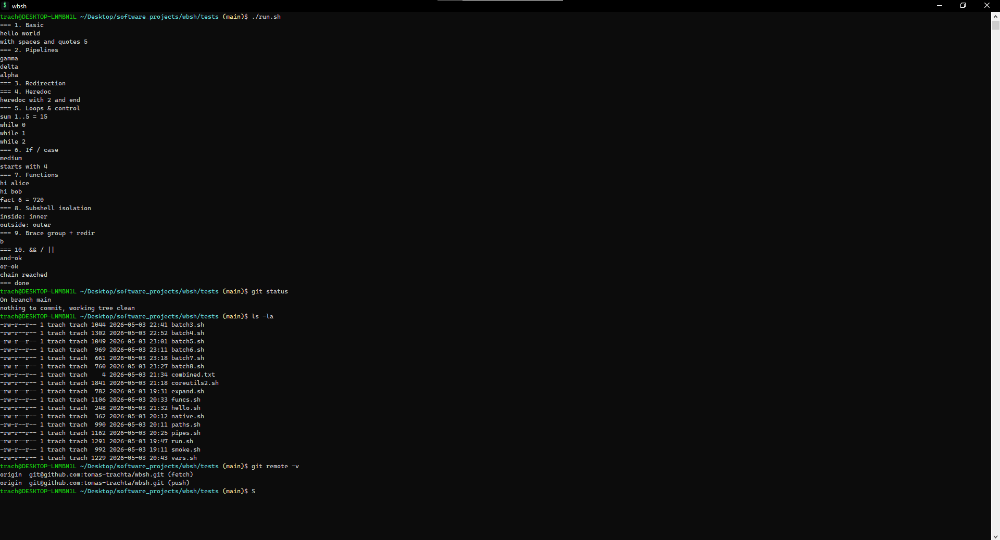
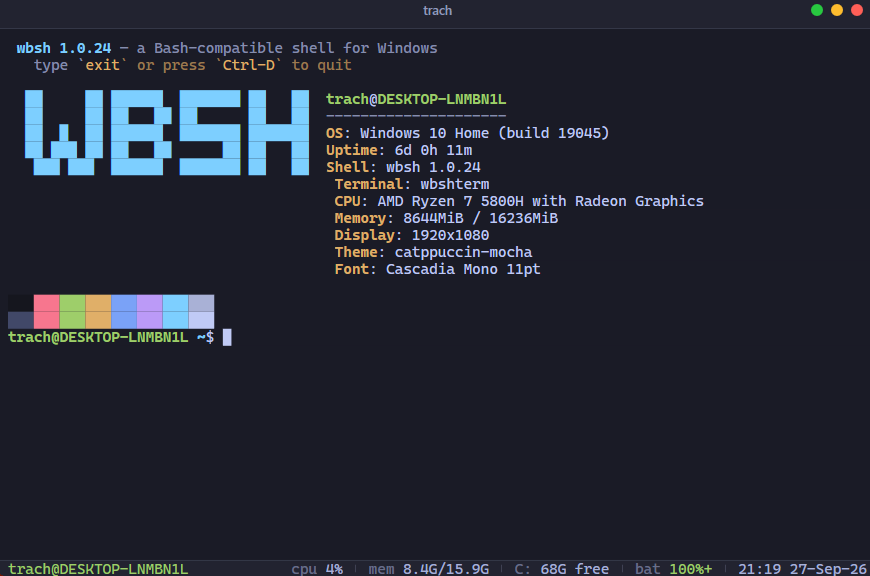

# wbsh

A Bash-compatible shell for Windows: a drop-in replacement for Git Bash,
written from scratch in C++17 with a real POSIX shell grammar, a readline-style
line editor, and bundled coreutils so a fresh install is useful immediately.



> Status: **early but released.** Tagged 1.x releases exist and a golden test
> suite covers the shell, but it is run by hand, with no CI on push yet, and
> behavior may change between minor versions.

---

## Why wbsh

Git Bash is a thin re-skin of MSYS2, and its quirks leak through: PATH
translation surprises, slow `fork` emulation, an aging MinTTY. wbsh is built
for modern Windows instead:

- **Native console.** VT-mode output and immersive dark mode; renders correctly
  in Windows Terminal, conhost, VS Code, and JetBrains terminals.
- **One self-contained binary.** No MSYS or Cygwin layer. ~4 MB exe, ~3 MB
  installer including the VC++ runtime.
- **Real Bash semantics.** Lexer, parser, AST and expander, not a wrapper
  around `cmd.exe`.
- **Bundled coreutils.** `ls`, `grep`, `sed`, `awk`, `find`, `tar`, `curl`,
  hashes and more are built in. System `git`, `vim`, `less` are auto-discovered.
- **Path translation.** `/c/Users/...` ↔ `C:\Users\...` when invoking native
  Windows executables.

---

## Install

Get these from [Releases](https://github.com/tomas-trachta/wbsh/releases):

| Download | What you get |
| --- | --- |
| `wbsh-setup-x64.exe` | Per-user installer, no UAC. Installs to `%LOCALAPPDATA%\Programs\wbsh`, with opt-in tasks to add `wbsh` to your `PATH` and an "Open wbsh here" Explorer context-menu entry. |
| `wbshterm-setup-x64.exe` | The terminal below. It bundles `wbsh.exe`, so it works on its own; installing both is fine. |
| `wbsh-<version>-portable-x64.zip`, `wbshterm-<version>-portable-x64.zip` | Extract and run. No registry, no PATH changes. |

winget and scoop packages are not published yet.

For a "wbsh" profile in Windows Terminal, copy
`installer/windows-terminal/wbsh.json` to
`%LOCALAPPDATA%\Microsoft\Windows Terminal\Fragments\wbsh\`. The installer does
not do this step.

### wbshterm

A terminal that hosts wbsh on a pseudoconsole, with themes, a config file,
scrollback and selection, tmux-style panes, and shell integration. See
[wbshterm/README.md](wbshterm/README.md).



---

## Quick start

Start an interactive shell with `wbsh`:

```sh
$ wbsh
trach@DESKTOP /c/Users/trach (main)$ ls
Documents  Downloads  Desktop  ...
```

Run a command with `-c`, and a script with `-r`:

```sh
$ wbsh -c 'for i in {1..3}; do printf "%02d\n" "$((i * 7))"; done'
07
14
21

$ wbsh -r script.sh
```

> **A script file needs `-r`, unlike in bash.** Without it, `wbsh <file>` only
> prints a parse tree, as a debugging aid, and runs nothing. `wbsh -c` runs the
> command, as in bash, so wbsh works as `$SHELL -c`; `wbsh --ast -c` dumps it.

Pipelines, redirection, control flow, functions, command substitution,
arithmetic, brace, parameter, tilde and glob expansion, here-docs, here-strings,
traps and job control (`Ctrl-Z`, `jobs`, `fg`, `bg`) all work.

```
wbsh                                 interactive shell (TTY auto-detect)
wbsh [opts] -c <command> [name [arg ...]]
                                     run the given string ($0 = name)
wbsh [opts] <file> [arg ...]         run / dump the file ($1.. = args)
wbsh [opts] - [arg ...]              run / dump stdin (also -s)
options end at the first operand or at --; later words are arguments

  -i, --interactive                  force interactive REPL
  -r, --run                          execute the file or stdin
  -e, --expand                       dump expanded words
  -t, --tokens                       dump the token stream
  --ast                              dump the AST (with -c and no -r: dump only)
  --no-ast                           suppress the AST dump
  -h, --help                         show help
  -v, --version                      print the version
  --agent-info                       print a longer brief for scripts and tools
```

---

## Line editing

- **History:** persistent, with reverse-incremental search.
- **Predictions:** the rest of the best matching history entry appears as dim
  ghost text. Entries whose last run failed are never suggested.
- **Completion:** programmable, plus per-tool completion for git, docker, npm,
  cargo and kubectl.
- **Kill ring:** kills are kept, and yanking cycles through them.

### Keys

Bindings follow readline's emacs mode. `Esc` followed by a key works as Alt
with it, and AltGr characters type as usual. For vi keys, use `set -o vi` (or
`set editing-mode vi` in `~/.inputrc`). `set -o emacs` sets the emacs keys
again.

**Moving**

| Keys | Action |
|------|--------|
| `← / →`, `Ctrl-B / Ctrl-F`           | move by one character |
| `Alt-B / Alt-F`, `Ctrl-← / Ctrl-→`   | move by one word |
| `Home / End`, `Ctrl-A / Ctrl-E`      | start / end of line |

**Completion and history**

| Keys | Action |
|------|--------|
| `Tab`                                | complete; second `Tab` lists candidates |
| `→` at end of line                   | accept the inline prediction |
| `↑ / ↓`, `Ctrl-P / Ctrl-N`           | walk history |
| `Ctrl-R` / `Ctrl-S`                  | search history backward / forward |
| `Esc` / `Ctrl-G`                     | cancel the search |
| `Alt-.` / `Alt-_`                    | insert the last word of the previous command (repeat: older ones) |

**Editing**

| Keys | Action |
|------|--------|
| `Ctrl-U / Ctrl-K`                    | kill to start / end of line |
| `Ctrl-W`                             | kill the previous whitespace-separated word |
| `Alt-Backspace / Alt-D`, `Ctrl-Del`  | kill the previous / next word |
| `Ctrl-Y`, `Alt-Y`                    | yank the last kill, then cycle older kills |
| `Ctrl-T` / `Alt-T`                   | swap characters / words |
| `Alt-U / Alt-L / Alt-C`              | upcase / downcase / capitalize the word |
| `Ctrl-_`, `Ctrl-X Ctrl-U` / `Alt-R`  | undo / undo every change to the line |
| `Ctrl-V`                             | paste from the clipboard |

**Everything else**

| Keys | Action |
|------|--------|
| `Ctrl-X Ctrl-E`                      | edit the line in `$VISUAL` / `$EDITOR` (default notepad), then run it |
| `Ctrl-O`                             | run the line, then show the next history entry |
| `Alt-#`                              | comment out the line and keep it in history |
| `Ctrl-L`                             | clear the screen |
| `Ctrl-C`                             | abandon the line |
| `Ctrl-D` (empty line)                | exit |

### Completing file names

- Names are quoted the way the word was typed (`"My Doc` → `"My Documents/`) or
  get backslashes (`My\ Documents/`).
- The value after `=` completes on its own (`--file=./sr`).
- Names match regardless of case. Put `set completion-ignore-case off` in
  `~/.inputrc` to change that.

### Changing bindings

The `bind` builtin changes them for the session:

- `bind -p` lists the bindings.
- `bind -l` lists the commands.
- `bind -x` runs a shell command with `READLINE_LINE` / `READLINE_POINT`.

`~/.inputrc` (or `$INPUTRC`) is read before `.wbshrc` and takes readline's
syntax, including `$if mode=emacs` ... `$endif` and `$include`:

```
"\C-t": transpose-chars
Meta-q: upcase-word
"\ez": "macro text"
set bell-style none
```

---

## Configuration

`~/.wbshrc` is sourced at the start of every interactive session:

```sh
export EDITOR=code
alias ll='ls -lah'
alias gs='git status'
PS1='\[\e[35;1m\]\w\[\e[0m\]\g \$ '
```

### Variables

| Variable | Effect |
| --- | --- |
| `PS1`, `PS2` | Primary and continuation prompts. |
| `PATH` | Stored in POSIX form, auto-translated for spawns. |
| `HOME` | Defaults to `%USERPROFILE%` in POSIX form. |
| `HISTFILE` | History file, default `$HOME/.wbsh_history`. Each command is appended as it finishes. Empty: not saved. |
| `HISTSIZE`, `HISTFILESIZE` | Entries kept in memory / in the file. Default 5000; negative: no limit. |
| `HISTCONTROL` | `ignorespace`, `ignoredups`, `ignoreboth`, `erasedups`. |
| `HISTIGNORE` | Colon-separated patterns left out of history (`&` = previous entry). |
| `COLUMNS`, `LINES` | Updated on resize; fires the `WINCH` trap. |
| `WBSH_GIT_NO_DIRTY` | Skip the working-tree check in the `\g` prompt, for huge repos. |
| `WBSH_GIT_STATUS_WAIT` | Milliseconds the prompt waits for `\g`'s background `git status`, default 50. After that it shows the last known state and redraws when the new one arrives. |
| `WBSH_NO_PATHCONV`, `MSYS_NO_PATHCONV` | Suppress POSIX→Win32 argument translation for spawned commands. |
| `WBSH_PAGER` | `builtin` makes `less` use the bundled pager even when a `less` is on PATH. |

### Prompt escapes

| Escape | Meaning |
| --- | --- |
| `\u` | user |
| `\h`, `\H` | short / long hostname |
| `\w`, `\W` | working directory / its basename |
| `\g` | ` (branch)` inside a git repo; ` (branch \| state)` during a merge, rebase, cherry-pick, revert or bisect, or when the tree has unstaged, staged or untracked changes |
| `\d` | date (`Tue May 26`) |
| `\t`, `\T`, `\@`, `\A` | time: 24-hour, 12-hour, 12-hour am/pm, 24-hour `HH:MM` |
| `\D{format}` | `strftime` format |
| `\s` | `wbsh` |
| `\v`, `\V` | version: short / long |
| `\j` | number of jobs |
| `\!`, `\#` | history number / command number |
| `\l` | terminal name |
| `\n` `\r` `\a` `\e` `\\` `\$` `\nnn` | the usual characters; `\nnn` is octal |
| `\[`, `\]` | non-printing markers |

Default `PS1`:

```
\[\e[32;1m\]\u@\h\[\e[0m\] \[\e[36;1m\]\w\[\e[0m\]\g\$
```

---

## Commands

Everything below is built in. [docs/commands.md](docs/commands.md) has flags,
per-command notes, and what wbsh does where Windows differs from Linux: `exec`,
signals, `/proc`, FIFOs, `nohup`, cron and more.

**Shell:** `:`, `true`, `false`, `echo`, `printf`, `exec`, `pwd`, `cd`, `exit`,
`logout`, `return`, `break`, `continue`, `export`, `unset`, `shift`, `set`,
`eval`, `source` / `.`, `type`, `command`, `builtin`, `enable`, `read`, `test` /
`[`, `local`, `alias`, `unalias`, `history`, `fc`, `bind`, `trap`, `getopts`,
`declare` / `typeset`, `mapfile` / `readarray`, `shopt`, `let`, `umask`,
`ulimit`, `hash`, `times`, `caller`, `help`, `compgen`, `complete`, `compopt`,
`readonly`, `jobs`, `wait`, `fg`, `bg`, `disown`, `suspend`, `pushd`, `popd`,
`dirs`.

**Files:** `ls`, `cat`, `cp`, `mv`, `rm`, `mkdir`, `mkfifo`, `mknod`, `rmdir`,
`touch`, `ln`, `link`, `unlink`, `stat`, `chmod`, `chown`, `chgrp`, `chattr`,
`lsattr`, `install`, `file`, `du`, `df`, `realpath`, `readlink`, `basename`,
`dirname`, `find`, `dd`, `split`, `truncate`, `shred`, `sync`, `fsync`,
`flock`, `mktemp`.

**Text:** `head`, `tail`, `wc`, `sort`, `uniq`, `tr`, `cut`, `tee`, `paste`,
`join`, `tac`, `rev`, `nl`, `fold`, `column`, `expand`, `unexpand`, `comm`,
`shuf`, `tsort`, `strings`, `grep` / `egrep` / `fgrep`, `sed`, `awk` / `gawk`,
`diff`, `cmp`, `patch`, `dos2unix`, `unix2dos`, `iconv`, `xargs`, `less`,
`more`, `vi` / `view`, `ed`.

**Encoding and hashing:** `base64`, `base32`, `uuencode`, `uudecode`, `xxd`,
`od`, `hexdump`, `hd`, `md5sum`, `sha1sum`, `sha256sum`, `sha384sum`,
`sha512sum`, `sha3sum`, `cksum`, `sum`, `crc32`.

**Archives and compression:** `tar`, `gzip`, `gunzip`, `zcat`, `bzip2`,
`bunzip2`, `bzcat`, `xz`, `unxz`, `xzcat`, `lzma`, `unlzma`, `lzcat`, `lzop`,
`unlzop`, `lzopcat`, `uncompress`, `zip`, `unzip`, `cpio`, `ar`.

**Processes and system:** `ps`, `pgrep`, `pkill`, `pidof`, `kill`, `killall`,
`top`, `nice`, `renice`, `nohup`, `setsid`, `timeout`, `watch`, `script`,
`unbuffer`, `crontab`, `crond`, `uptime`, `free`, `nproc`, `env`, `printenv`,
`whoami`, `logname`, `groups`, `id`, `su`, `sudo`, `hostname`, `uname`, `date`,
`cal`, `sleep`, `usleep`, `stty`, `reset`, `tput`, `ttysize`, `clear`,
`locale`.

**Network:** `curl`, `wget`, `nc` / `netcat`, `ftp`, `ftpget`, `ftpput`,
`whois`, `httpd`.

**Other:** `seq`, `expr`, `bc`, `dc`, `factor`, `getopt`, `uuidgen`, `ascii`,
`ipcalc`, `ts`, `yes`, `which`, `make` / `gmake`, `man`, `apropos`, `whatis`,
`fzf`, `tmux`, `utils`.

`git`, `vim`, `less`, `ssh` and the like are expected on PATH; `git` is
auto-discovered from the standard install locations.

---

## Third-party utils

A util is a DLL dropped into `plugins`: its commands join the shell and its
segments join the terminal's status bar, with no rebuild or registration.

```
$ utils
hello            1.0.0      A worked example: one command and one status segment.
$ hello Tomas | tr a-z A-Z
HELLO, TOMAS!
```

| Folder | For |
| --- | --- |
| `<install>\plugins\` | Utils that ship with an install |
| `%APPDATA%\wbsh\plugins\` | A user's own, no administrator needed |
| each folder in `WBSH_PLUGINS` | A developer's own build output |

- **Commands:** a util's command redirects, pipes and sets `$?` like any other,
  has `help` text and Tab completion of its own, and cannot take a bundled
  command's name.
- **Contract:** C (`sdk/include/wbshsdk.h`), ABI-versioned and unlinked. The
  host hands a util a table of functions when it loads, so any compiler that
  makes a DLL will do.
- **Failures:** a mismatched or non-util DLL is named and skipped without
  affecting the others, and `utils` says why.
- **Development:** `utils load <dll>` and `utils reload` keep the edit-run loop
  inside one shell.
- **Optional:** `wbsh.exe` reaches the SDK through `LoadLibrary`, so without
  `wbshsdk.dll` beside it the shell runs exactly as before.

Every release carries `wbsh-sdk-<version>.zip` with the header, a template
project for MSBuild and CMake, the samples and the SDK's symbols. See
[sdk/README.md](sdk/README.md) to write one.

---

## Building from source

Requires Windows 10 1903+, Visual Studio 2022 or Build Tools 2022 with the
**Desktop development with C++** workload, and optionally
[Inno Setup 6](https://jrsoftware.org/isdl.php) for the installer.

```powershell
& "$env:ProgramFiles\Microsoft Visual Studio\2022\Community\MSBuild\Current\Bin\MSBuild.exe" `
    .\wbsh\wbsh.vcxproj -p:Configuration=Release -p:Platform=x64

.\installer\build.ps1                        # installers, portable ZIPs and the SDK ZIP, version from version.props
```

The binary lands at `x64\Release\wbsh.exe`; installer output goes to
`installer\output\`.

### Layout

```
wbsh/        The shell: wbsh.vcxproj, src/, tests/ (golden suite, run-all.sh), stress/
wbshterm/    The terminal: Win32 window, renderer, VT parser, panes; vendored ConPTY;
             tests/, stress/
sdk/         The util SDK: wbshsdk.dll, include/wbshsdk.h, template/, samples/, tests/
installer/   Inno Setup scripts, build.ps1, Windows Terminal profile fragment
tools/       check_style.py (runs before every build), gen_charwidth.py, make_icon.py,
             stress/ (code shared by the two stress suites)
docs/        Command notes, stress-test notes; Doxygen config, regenerate with
             `doxygen docs/Doxyfile`
```

[CONTRIBUTING.md](./CONTRIBUTING.md) has the file-by-file architecture tour.

---

## Testing

```sh
# From wbsh/tests/, after building:
../../x64/Release/wbsh.exe -r run-all.sh                  # every script exits 0
WBSH_GOLDEN=1 ../../x64/Release/wbsh.exe -r run-all.sh    # also diff against expected/
```

From PowerShell, `.\wbsh\tests\run-all.ps1` runs the same suite; add `-Golden`
to diff against `expected/`.

Each `wbsh/tests/*.sh` script exercises one slice of behavior and runs inside
wbsh itself, so the suite is an end-to-end check of the whole pipeline. The SDK
has its own checks in `sdk\tests\sdk.ps1`, which need the samples built into
`x64/Release/plugins`.

---

## Comparison

|                          | wbsh         | Git Bash      | MSYS2          | Cygwin       | WSL              |
|--------------------------|--------------|---------------|----------------|--------------|------------------|
| Native Windows binary    | yes          | yes (MSYS)    | yes (MSYS)     | yes          | no (Linux VM)    |
| Single-binary install    | **yes**      | no            | no             | no           | no               |
| Coreutils bundled        | **yes**      | yes (MSYS)    | yes (pacman)   | yes          | yes              |
| Modern console (VT mode) | **yes**      | MinTTY        | MinTTY         | MinTTY       | n/a              |
| `fork()` emulation       | spawn-only   | full (slow)   | full (slow)    | full (slow)  | n/a              |
| Real Linux syscalls      | no           | no            | no             | no           | yes              |

wbsh trades full POSIX behavior for being small, fast to start, and clean to
integrate. If you need a real Linux environment, use WSL.

---

## Roadmap

- CI running the golden suite on every push.
- winget / scoop publication and code-signed releases.

---

## Contributing

Pull requests welcome; see [CONTRIBUTING.md](./CONTRIBUTING.md) for the
architecture tour, conventions, test harness and PR checklist. In short: match
the existing style, one change per PR, add a test when changing executor
behavior, and have a clean Release build, `python tools/check_style.py` and the
golden suite green before opening it.

Bug reports should include the wbsh version, Windows build, and the smallest
reproducing script.

---

## License

[MIT](./LICENSE) © 2026 Tomas Trachta.
