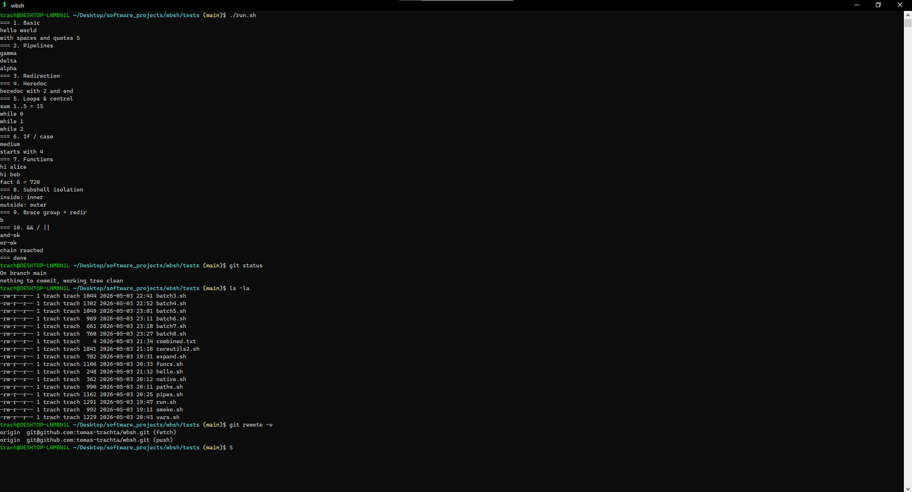
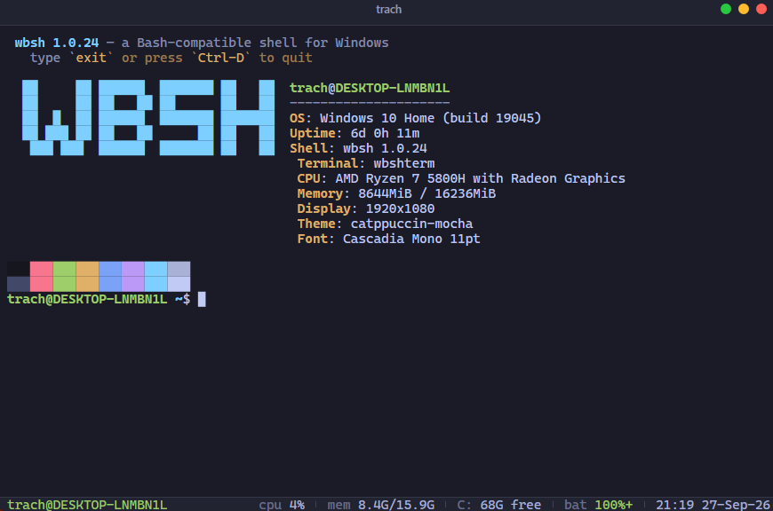

# wbsh

A Bash-compatible shell for Windows: a drop-in replacement for Git Bash,
written from scratch in C++17 with a real POSIX shell grammar, a readline-style
line editor, and bundled coreutils so a fresh install is useful immediately.



> Status: **early but released.** Tagged 1.x releases exist; CI builds every
> push and runs the golden suite, a differential comparison with GNU bash 5.3,
> bash's own test suites and a perf gate. Bash compatibility is measured, not
> assumed, and is still well short of complete (see the scoreboard and
> [Limitations](#limitations)). Behavior may change between minor versions.

---

## Why wbsh

Git Bash is a thin re-skin of MSYS2, and its quirks leak through: PATH
translation surprises, slow `fork` emulation, an aging MinTTY. wbsh is built
for modern Windows instead:

- **Native console.** VT-mode output and immersive dark mode; renders correctly
  in Windows Terminal, conhost, VS Code, and JetBrains terminals.
- **One self-contained binary.** No MSYS or Cygwin layer. ~4 MB exe, ~3 MB
  installer including the VC++ runtime.
- **Real Bash semantics.** Lexer, parser, AST and expander, not a wrapper
  around `cmd.exe`.
- **Bundled coreutils.** `ls`, `grep`, `sed`, `awk`, `find`, `tar`, `curl`,
  hashes and more are built in. System `git`, `vim`, `less` are auto-discovered.
- **Path translation.** `/c/Users/...` ↔ `C:\Users\...` when invoking native
  Windows executables, by Git Bash's rules (`cmd //c`, `--opt=/c/x`,
  `MSYS2_ARG_CONV_EXCL`).

---

## Scoreboard

Measured, not claimed. Each number links to the committed raw data; the CI
job that reproduces it is in [`.github/workflows/ci.yml`](.github/workflows/ci.yml).

| metric | wbsh | data | CI job |
| --- | --- | --- | --- |
| Differential corpus vs GNU bash | 420 / 426 cases identical (vs bash 4.4, 2026-11-12); CI floor 400 vs bash 5.3 | [FINDINGS.md](tools/difftest/FINDINGS.md), [baseline.txt](tools/difftest/baseline.txt) | `difftest` |
| GNU bash 5.3 upstream suites | **68 / 86** byte-identical, 18 env-only, no real failures (2026-11-23) | [compat-ledger.md](docs/compat-ledger.md) | `bashtests` |
| Real-world assets sourced cleanly | 275 / 1,034 runs (26.6 %; Git Bash 969 / 1,034 on the same files) over oh-my-bash, bash-it, bash-completion, nvm, sdkman, asdf and git's completion scripts (2026-11-13) | [corpus snapshot](docs/corpus/2026-11-13-local.md) | local only |
| Speed vs Git Bash (same machine) | faster on every row: `-c true` 43 vs 66 ms, 20k function calls 196 vs 225 ms | [docs/bench/](docs/bench/2026-11-12-local.md) | `bench` (perf gate) |

[docs/comparison.md](docs/comparison.md) puts these next to Git Bash,
MSYS2 and WSL, with every cell sourced and dated.

---

## Install

Get these from [Releases](https://github.com/tomas-trachta/wbsh/releases):

| Download | What you get |
| --- | --- |
| `wbsh-setup-x64.exe`, `wbsh-setup-arm64.exe` | Per-user installer, no UAC. Installs to `%LOCALAPPDATA%\Programs\wbsh`; the tasks are listed below. |
| `wbshterm-setup-x64.exe`, `wbshterm-setup-arm64.exe` | The terminal below. It bundles `wbsh.exe`, so it works on its own; installing both is fine. |
| `wbsh-<version>-portable-x64.zip`, `wbshterm-<version>-portable-x64.zip` and the `-arm64.zip` twins | Extract and run. No registry, no PATH changes. |

The ARM64 builds are cross-compiled in CI and have not yet been run on ARM64
hardware by the maintainer; reports welcome.

The wbsh installer's tasks:

| task | default |
| --- | --- |
| Add wbsh to the user `PATH` | on |
| "Open wbsh here" in the Explorer context menu | on |
| A wbsh profile for Windows Terminal (a fragment in `%LOCALAPPDATA%\Microsoft\Windows Terminal\Fragments\wbsh\`; `settings.json` is not touched) | on |
| `bash.exe` and `sh.exe` shims in `{app}in`, added to the user `PATH`, for tools that look for Git Bash | off |
| Set `SHELL` to wbsh for your user | off |
| Install MinGit with winget, offered only when no `git.exe` is found | off |

Scoop installs straight from the manifests in this repository:

```powershell
scoop install https://raw.githubusercontent.com/tomas-trachta/wbsh/main/packaging/scoop/wbsh.json
```

winget manifests are generated with every release (see
[packaging/README.md](packaging/README.md)); they become
`winget install TomasTrachta.wbsh` once accepted into `microsoft/winget-pkgs`.
Every release from 1.1.2 on carries `SHA256SUMS.txt`.

Without the installer (portable ZIP, Scoop), copy
`installer/windows-terminal/wbsh.json` to
`%LOCALAPPDATA%\Microsoft\Windows Terminal\Fragments\wbsh\` for the Windows
Terminal profile. [docs/editors.md](docs/editors.md) shows how to make wbsh
the shell of VS Code, Cursor, JetBrains IDEs and Windows Terminal, and what
the shims and `SHELL` do. Releases are not code-signed yet; the signing step
is prepared and switches on once the SignPath Foundation account exists
([docs/signing.md](docs/signing.md)).

### wbshterm

A terminal that hosts wbsh on a pseudoconsole, with themes, a config file,
scrollback and selection, tmux-style panes, and shell integration. See
[wbshterm/README.md](wbshterm/README.md).



---

## Quick start

Start an interactive shell with `wbsh`:

```sh
$ wbsh
trach@DESKTOP /c/Users/trach (main)$ ls
Documents  Downloads  Desktop  ...
```

Run a command or a script exactly as with bash:

```sh
$ wbsh -c 'for i in {1..3}; do printf "%02d\n" "$((i * 7))"; done'
07
14
21

$ wbsh -eu -o pipefail script.sh arg1 arg2
```

Pipelines, redirection, control flow, functions, command substitution
(including bash 5.3's `${ cmd; }` and `${| cmd; }`), arithmetic, brace,
parameter, tilde and glob expansion, here-docs, here-strings, traps and job
control (`Ctrl-Z`, `jobs`, `fg`, `bg`) all work.

### Drop-in for bash.exe and sh.exe

The command line is bash's: option letters cluster (`-ec`), `-c` takes the
first operand after the options (`wbsh -c -l 'cmd'`), and `-o NAME`,
`-O NAME`, `-l`, `-i`, `-s`, `--norc`, `--noprofile`, `--rcfile` and
`--posix` mean what they mean to bash. A copy of `wbsh.exe` named `bash.exe`
behaves the same; one named `sh.exe` starts in POSIX mode. Tools that run
`$SHELL -c`, git hooks and Makefiles therefore work unchanged, and a coding
agent that wants Git Bash can be pointed at it (for Claude Code:
`CLAUDE_CODE_GIT_BASH_PATH=C:\path\to\bash.exe`).

A login shell (`-l`) reads `~/.wbsh_profile`, never the `~/.profile` written
for Git Bash or Linux; an interactive one then reads `~/.wbshrc` too.

### Quote-proof commands

Every program between a caller and the shell can re-quote, expand or eat
part of a command line. `--ec` (or `--encodedcommand`) takes the command as
base64 instead, so there is nothing left to escape:

```sh
$ wbsh --ec ZWNobyAiaGkgJDEiIHwgdHIgYS16IEEtWg== name arg
HI ARG
```

UTF-8 and UTF-16LE (PowerShell's `-EncodedCommand` encoding) are both
accepted; padding is optional, line breaks are ignored and an optional `v1:`
prefix is dropped. Options still go in front: `wbsh -eu --ec <b64>`.

### Structured results

`--json` runs the command the normal way (traps, `exit N`, `set -e`) with
stdout and stderr captured apart, then prints one line of JSON, so a caller
needs no output parsing:

```sh
$ wbsh --json -c 'echo hi; echo oops >&2; exit 3'
{"status":3,"stdout":"hi\n","stderr":"oops\n","duration_ms":4}
```

The line is pure ASCII (non-ASCII characters as `\uXXXX`, so it parses
whatever code page the reader decodes it with); bytes that are not valid
UTF-8 become U+FFFD, one per byte. The exit status is the command's. It
combines with `--ec` and script files: `wbsh --json --ec <b64>`.

Coding agents: [docs/agents.md](docs/agents.md) shows how to point Claude
Code, Codex CLI, OpenCode and others at wbsh, and what
`tools/agents/check_agent_shapes.py` verifies about each of them.

```
wbsh [options]                         interactive shell (TTY auto-detect)
wbsh [options] -c <command> [name [arg ...]]
                                       run the command ($0 = name)
wbsh [options] <file> [arg ...]        run the file ($1.. = args)
wbsh [options] -s [arg ...]            run stdin (also a lone -)
wbsh [options] --ec <base64> [name [arg ...]]
wbsh --json [options] -c <command>     one JSON line: status, stdout, stderr

  -c, -s, -i, -l                       as in bash
  -abefhkmnptuvxBCEHPT                 the `set` letters (+x turns one off)
  -o NAME / +o NAME, -O NAME / +O NAME set / unset by name, shopt names
  --login, --posix, --norc, --noprofile, --rcfile FILE
  --tokens, --ast, --expand            debugging dumps instead of running
                                       (add -r / --run to dump and run)
  -h, --help                           show help
  --version                            version and the commit it was built from
  --agent-info                         a longer brief for scripts and tools
```

---

## Line editing

- **History:** persistent, with reverse-incremental search.
- **Predictions:** the rest of the best matching history entry appears as dim
  ghost text. Entries whose last run failed are never suggested.
- **Completion:** programmable, plus per-tool completion for git, docker, npm,
  cargo and kubectl.
- **Kill ring:** kills are kept, and yanking cycles through them.
- **Syntax highlighting:** the line is coloured as you type (see below).

### Syntax highlighting

Command words are green when they name a builtin, function, alias or program
on `PATH`, and red when they name nothing. Keywords, strings, expansions,
comments and options get colours of their own, and paths that exist are
underlined. Lines that continue an unfinished command are coloured in context.
Command lookups come from memory (`PATH` is listed once, off the typing thread)
and paths on network drives are never probed, so a key costs about 20 µs more.

Highlighting is on by default and off under `NO_COLOR` or `TERM=dumb`. In
`~/.inputrc`:

```
set syntax-highlight off
set syntax-highlight-colors command=1;32:unknown=31:keyword=35
```

`WBSH_HIGHLIGHT` takes the same `role=SGR` list and wins over `.inputrc`. The
roles are `command` (32), `unknown` (31), `keyword` (35), `string` (33),
`variable` (36), `comment` (90), `operator` (none), `option` (94) and `path` (4).
`0` turns a role's colour off. The colours are the 16 ANSI ones, so wbshterm
draws them in its theme's palette.

### Keys

Bindings follow readline's emacs mode. `Esc` followed by a key works as Alt
with it, and AltGr characters type as usual. For vi keys, use `set -o vi` (or
`set editing-mode vi` in `~/.inputrc`). `set -o emacs` sets the emacs keys
again.

**Moving**

| Keys | Action |
|------|--------|
| `← / →`, `Ctrl-B / Ctrl-F`           | move by one character |
| `Alt-B / Alt-F`, `Ctrl-← / Ctrl-→`   | move by one word |
| `Home / End`, `Ctrl-A / Ctrl-E`      | start / end of line |

**Completion and history**

| Keys | Action |
|------|--------|
| `Tab`                                | complete; second `Tab` lists candidates |
| `→` at end of line                   | accept the inline prediction |
| `↑ / ↓`, `Ctrl-P / Ctrl-N`           | walk history |
| `Ctrl-R` / `Ctrl-S`                  | search history backward / forward |
| `Esc` / `Ctrl-G`                     | cancel the search |
| `Alt-.` / `Alt-_`                    | insert the last word of the previous command (repeat: older ones) |

**Editing**

| Keys | Action |
|------|--------|
| `Ctrl-U / Ctrl-K`                    | kill to start / end of line |
| `Ctrl-W`                             | kill the previous whitespace-separated word |
| `Alt-Backspace / Alt-D`, `Ctrl-Del`  | kill the previous / next word |
| `Ctrl-Y`, `Alt-Y`                    | yank the last kill, then cycle older kills |
| `Ctrl-T` / `Alt-T`                   | swap characters / words |
| `Alt-U / Alt-L / Alt-C`              | upcase / downcase / capitalize the word |
| `Ctrl-_`, `Ctrl-X Ctrl-U` / `Alt-R`  | undo / undo every change to the line |
| `Ctrl-V`                             | paste from the clipboard |

**Everything else**

| Keys | Action |
|------|--------|
| `Ctrl-X Ctrl-E`                      | edit the line in `$VISUAL` / `$EDITOR` (default notepad), then run it |
| `Ctrl-O`                             | run the line, then show the next history entry |
| `Alt-#`                              | comment out the line and keep it in history |
| `Ctrl-L`                             | clear the screen |
| `Ctrl-C`                             | abandon the line |
| `Ctrl-D` (empty line)                | exit |

### Completing file names

- Names are quoted the way the word was typed (`"My Doc` → `"My Documents/`) or
  get backslashes (`My\ Documents/`).
- The value after `=` completes on its own (`--file=./sr`).
- Names match regardless of case. Put `set completion-ignore-case off` in
  `~/.inputrc` to change that.

### Changing bindings

The `bind` builtin changes them for the session:

- `bind -p` lists the bindings.
- `bind -l` lists the commands.
- `bind -x` runs a shell command with `READLINE_LINE` / `READLINE_POINT`.

`~/.inputrc` (or `$INPUTRC`) is read before `.wbshrc` and takes readline's
syntax, including `$if mode=emacs` ... `$endif` and `$include`:

```
"\C-t": transpose-chars
Meta-q: upcase-word
"\ez": "macro text"
set bell-style none
```

---

## Configuration

`~/.wbshrc` is sourced at the start of every interactive session.
A login shell (`wbsh -l`, `wbsh -lc <command>`) first sources
`~/.wbsh_profile` and sets `shopt login_shell`. wbsh does not read
`~/.bash_profile` or `~/.profile`, because those files are written for
Git Bash or Linux. Unlike bash, an interactive login shell also reads
`~/.wbshrc` after the profile.

An example `~/.wbshrc`:

```sh
export EDITOR=code
alias ll='ls -lah'
alias gs='git status'
PS1='\[\e[35;1m\]\w\[\e[0m\]\g \$ '
```

### Variables

| Variable | Effect |
| --- | --- |
| `PS1`, `PS2` | Primary and continuation prompts. |
| `PATH` | Stored in POSIX form, auto-translated for spawns. |
| `HOME` | Defaults to `%USERPROFILE%` in POSIX form. |
| `HISTFILE` | History file, default `$HOME/.wbsh_history`. Each command is appended as it finishes. Empty: not saved. |
| `HISTSIZE`, `HISTFILESIZE` | Entries kept in memory / in the file. Default 5000; negative: no limit. |
| `HISTCONTROL` | `ignorespace`, `ignoredups`, `ignoreboth`, `erasedups`. |
| `HISTIGNORE` | Colon-separated patterns left out of history (`&` = previous entry). |
| `COLUMNS`, `LINES` | Updated on resize; fires the `WINCH` trap. |
| `WBSH_GIT_NO_DIRTY` | Skip the working-tree check in the `\g` prompt, for huge repos. |
| `WBSH_GIT_STATUS_WAIT` | Milliseconds the prompt waits for `\g`'s background `git status`, default 50. After that it shows the last known state and redraws when the new one arrives. |
| `WBSH_NO_PATHCONV`, `MSYS_NO_PATHCONV` | Suppress POSIX→Win32 argument translation for spawned commands. |
| `MSYS2_ARG_CONV_EXCL` | `*`, or `;`-separated prefixes of arguments to pass on untranslated, as in Git Bash. See [argument translation](docs/commands.md#arguments-for-native-programs). |
| `MSYSTEM` | Exported as `MINGW64` when not set; picks the `uname -s` prefix. |
| `WBSH_UNAME_S` | Replaces what `uname -s` prints (default `MINGW64_NT-10.0-<build>`). |
| `WBSH_PAGER` | `builtin` makes `less` use the bundled pager even when a `less` is on PATH. |

### Prompt escapes

| Escape | Meaning |
| --- | --- |
| `\u` | user |
| `\h`, `\H` | short / long hostname |
| `\w`, `\W` | working directory / its basename |
| `\g` | ` (branch)` inside a git repo; ` (branch \| state)` during a merge, rebase, cherry-pick, revert or bisect, or when the tree has unstaged, staged or untracked changes |
| `\d` | date (`Tue May 26`) |
| `\t`, `\T`, `\@`, `\A` | time: 24-hour, 12-hour, 12-hour am/pm, 24-hour `HH:MM` |
| `\D{format}` | `strftime` format |
| `\s` | `wbsh` |
| `\v`, `\V` | version: short / long |
| `\j` | number of jobs |
| `\!`, `\#` | history number / command number |
| `\l` | terminal name |
| `\n` `\r` `\a` `\e` `\\` `\$` `\nnn` | the usual characters; `\nnn` is octal |
| `\[`, `\]` | non-printing markers |

Default `PS1`:

```
\[\e[32;1m\]\u@\h\[\e[0m\] \[\e[36;1m\]\w\[\e[0m\]\g\$
```

---

## Commands

Everything below is built in. [docs/commands.md](docs/commands.md) has flags,
per-command notes, and what wbsh does where Windows differs from Linux: `exec`,
signals, `/proc`, FIFOs, `nohup`, cron and more.

**Shell:** `:`, `true`, `false`, `echo`, `printf`, `exec`, `pwd`, `cd`, `exit`,
`logout`, `return`, `break`, `continue`, `export`, `unset`, `shift`, `set`,
`eval`, `source` / `.`, `type`, `command`, `builtin`, `enable`, `read`, `test` /
`[`, `local`, `alias`, `unalias`, `history`, `fc`, `bind`, `trap`, `getopts`,
`declare` / `typeset`, `mapfile` / `readarray`, `shopt`, `let`, `umask`,
`ulimit`, `hash`, `times`, `caller`, `help`, `compgen`, `complete`, `compopt`,
`readonly`, `jobs`, `wait`, `fg`, `bg`, `disown`, `suspend`, `pushd`, `popd`,
`dirs`.

**Files:** `ls`, `cat`, `cp`, `mv`, `rm`, `mkdir`, `mkfifo`, `mknod`, `rmdir`,
`touch`, `ln`, `link`, `unlink`, `stat`, `chmod`, `chown`, `chgrp`, `chattr`,
`lsattr`, `install`, `file`, `du`, `df`, `realpath`, `readlink`, `basename`,
`dirname`, `find`, `dd`, `split`, `truncate`, `shred`, `sync`, `fsync`,
`flock`, `mktemp`.

**Text:** `head`, `tail`, `wc`, `sort`, `uniq`, `tr`, `cut`, `tee`, `paste`,
`join`, `tac`, `rev`, `nl`, `fold`, `column`, `expand`, `unexpand`, `comm`,
`shuf`, `tsort`, `strings`, `grep` / `egrep` / `fgrep`, `sed`, `awk` / `gawk`,
`diff`, `cmp`, `patch`, `dos2unix`, `unix2dos`, `iconv`, `xargs`, `less`,
`more`, `vi` / `view`, `ed`.

**Encoding and hashing:** `base64`, `base32`, `uuencode`, `uudecode`, `xxd`,
`od`, `hexdump`, `hd`, `md5sum`, `sha1sum`, `sha256sum`, `sha384sum`,
`sha512sum`, `sha3sum`, `cksum`, `sum`, `crc32`.

**Archives and compression:** `tar`, `gzip`, `gunzip`, `zcat`, `bzip2`,
`bunzip2`, `bzcat`, `xz`, `unxz`, `xzcat`, `lzma`, `unlzma`, `lzcat`, `lzop`,
`unlzop`, `lzopcat`, `uncompress`, `zip`, `unzip`, `cpio`, `ar`.

**Processes and system:** `ps`, `pgrep`, `pkill`, `pidof`, `kill`, `killall`,
`top`, `nice`, `renice`, `nohup`, `setsid`, `timeout`, `watch`, `script`,
`unbuffer`, `crontab`, `crond`, `uptime`, `free`, `nproc`, `env`, `printenv`,
`whoami`, `logname`, `groups`, `id`, `su`, `sudo`, `hostname`, `uname`, `date`,
`cal`, `sleep`, `usleep`, `stty`, `reset`, `tput`, `ttysize`, `clear`,
`locale`.

**Network:** `curl`, `wget`, `nc` / `netcat`, `ftp`, `ftpget`, `ftpput`,
`whois`, `httpd`.

**Git Bash helpers:** `cygpath`, `start`, `winpty`.

**Other:** `seq`, `expr`, `bc`, `dc`, `factor`, `getopt`, `uuidgen`, `ascii`,
`ipcalc`, `ts`, `yes`, `which`, `make` / `gmake`, `man`, `apropos`, `whatis`,
`fzf`, `tmux`, `utils`.

`git`, `vim`, `less`, `ssh` and the like are expected on PATH; `git` is
auto-discovered from the standard install locations.

---

## Third-party utils

A util is a DLL dropped into `plugins`: its commands join the shell and its
segments join the terminal's status bar, with no rebuild or registration.

```
$ utils
hello            1.0.0      A worked example: one command and one status segment.
$ hello Tomas | tr a-z A-Z
HELLO, TOMAS!
```

| Folder | For |
| --- | --- |
| `<install>\plugins\` | Utils that ship with an install |
| `%APPDATA%\wbsh\plugins\` | A user's own, no administrator needed |
| each folder in `WBSH_PLUGINS` | A developer's own build output |

- **Commands:** a util's command redirects, pipes and sets `$?` like any other,
  has `help` text and Tab completion of its own, and cannot take a bundled
  command's name.
- **Contract:** C (`sdk/include/wbshsdk.h`), ABI-versioned and unlinked. The
  host hands a util a table of functions when it loads, so any compiler that
  makes a DLL will do.
- **Failures:** a mismatched or non-util DLL is named and skipped without
  affecting the others, and `utils` says why.
- **Development:** `utils load <dll>` and `utils reload` keep the edit-run loop
  inside one shell.
- **Optional:** `wbsh.exe` reaches the SDK through `LoadLibrary`, so without
  `wbshsdk.dll` beside it the shell runs exactly as before.

Every release carries `wbsh-sdk-<version>.zip` with the header, a template
project for MSBuild and CMake, the samples and the SDK's symbols. See
[sdk/README.md](sdk/README.md) to write one.

---

## Building from source

Requires Windows 10 1903+, Visual Studio 2022 or Build Tools 2022 with the
**Desktop development with C++** workload, and optionally
[Inno Setup 6](https://jrsoftware.org/isdl.php) for the installer.

```powershell
& "$env:ProgramFiles\Microsoft Visual Studio\2022\Community\MSBuild\Current\Bin\MSBuild.exe" `
    .\wbsh\wbsh.vcxproj -p:Configuration=Release -p:Platform=x64

.\installer\build.ps1                        # installers, portable ZIPs and the SDK ZIP, version from version.props
```

The binary lands at `x64\Release\wbsh.exe`; installer output goes to
`installer\output\`.

### Layout

```
wbsh/        The shell: wbsh.vcxproj, src/, tests/ (golden suite, run-all.sh), stress/
wbshterm/    The terminal: Win32 window, renderer, VT parser, panes; vendored ConPTY;
             tests/, stress/
sdk/         The util SDK: wbshsdk.dll, include/wbshsdk.h, template/, samples/, tests/
installer/   Inno Setup scripts, build.ps1, Windows Terminal profile fragment
tools/       check_style.py (runs before every build), gen_charwidth.py, make_icon.py,
             stress/ (code shared by the two stress suites)
docs/        Command notes, stress-test notes; Doxygen config, regenerate with
             `doxygen docs/Doxyfile`
```

[CONTRIBUTING.md](./CONTRIBUTING.md) has the file-by-file architecture tour.

---

## Testing

```sh
# From wbsh/tests/, after building:
../../x64/Release/wbsh.exe -r run-all.sh                  # every script exits 0
WBSH_GOLDEN=1 ../../x64/Release/wbsh.exe -r run-all.sh    # also diff against expected/
```

From PowerShell, `.\wbsh\tests\run-all.ps1` runs the same suite; add `-Golden`
to diff against `expected/`.

Each `wbsh/tests/*.sh` script exercises one slice of behavior and runs inside
wbsh itself, so the suite is an end-to-end check of the whole pipeline. The SDK
has its own checks in `sdk\tests\sdk.ps1`, which need the samples built into
`x64/Release/plugins`. CI runs both on every push.

### Differential tests against GNU bash

`tools/difftest/` holds 440 small scripts run under GNU bash 5.3 (built from
source on Linux in CI) and under wbsh, with the outputs compared after a few
documented normalizations. CI reports the pass count on every push; the known
divergences are listed in `tools/difftest/FINDINGS.md`.

```sh
python -I tools/difftest/run.py --shell bash --record ref/
python -I tools/difftest/run.py --shell x64/Release/wbsh.exe --compare ref/ --diff
```

### GNU bash's own test suites and the real-world corpus

`tools/bashtests/run.py` downloads bash-5.3, checks its SHA-256 and runs
its 86 `tests/run-*` suites under wbsh
([docs/compat-ledger.md](docs/compat-ledger.md)). `tools/corpus/run.py`
sources oh-my-bash, bash-it, bash-completion, nvm, sdkman, asdf and git's
completion scripts at pinned commits under wbsh and Git Bash
([docs/corpus/](docs/corpus/2026-11-13-local.md)).

```sh
python -I tools/bashtests/run.py --shell x64/Release/wbsh.exe --fetch C:/cache/bash-src --jobs 2
python -I tools/corpus/run.py --shell wbsh=x64/Release/wbsh.exe     --shell "git-bash=C:/Program Files/Git/bin/bash.exe" --clone-root C:/scratch/corpus-src
```

### Benchmarks

`tools/bench/bench.py` times startup, function calls, arithmetic, string and
array loops, built-in pipelines, 150 native spawns, `$( )` and read loops under
any number of shells. Committed results are in [docs/bench/](./docs/bench/).
The `bench` CI job is a perf gate: it fails a push that makes any case more
than 20 % slower relative to Git Bash on the same runner (see
[tools/bench/README.md](tools/bench/README.md#perf-gate)).

---

## Comparison

|                          | wbsh         | Git Bash      | MSYS2          | Cygwin       | WSL              |
|--------------------------|--------------|---------------|----------------|--------------|------------------|
| Native Windows binary    | yes          | yes (MSYS)    | yes (MSYS)     | yes          | no (Linux VM)    |
| Single-binary install    | **yes**      | no            | no             | no           | no               |
| Coreutils bundled        | **yes**      | yes (MSYS)    | yes (pacman)   | yes          | yes              |
| Modern console (VT mode) | **yes**      | MinTTY        | MinTTY         | MinTTY       | n/a              |
| `fork()` emulation       | spawn-only   | full (slow)   | full (slow)    | full (slow)  | n/a              |
| Real Linux syscalls      | no           | no            | no             | no           | yes              |
| Signals to programs      | wbsh only¹   | MSYS only     | MSYS only      | Cygwin only  | yes              |
| pty for child programs   | console²     | MSYS pty      | MSYS pty       | Cygwin pty   | yes              |
| Permission bits          | emulated³    | `noacl`       | `noacl`        | NTFS ACLs    | yes              |

¹ A wbsh can trap what another wbsh sends; any other program is terminated
with exit code 128 + n. ² `script` and `unbuffer` give a command a ConPTY.
³ Read-only attribute plus mode bits kept in an NTFS stream, read only by
wbsh and its commands.

wbsh trades full POSIX behavior for being small, fast to start, and clean to
integrate. If you need a real Linux environment, use WSL. What that trade
means in practice is listed in
[docs/posix-differences.md](docs/posix-differences.md); a sourced, dated
comparison with the other ways to get bash on Windows is in
[docs/comparison.md](docs/comparison.md).

---

## Limitations

What wbsh does not do, or does differently, today. The compatibility
numbers above are the authoritative list; this is the summary. The
process, signal, permission, file-system and terminal differences are
detailed in [docs/posix-differences.md](docs/posix-differences.md).

- **Not GNU bash.** wbsh is its own implementation. It passes 68 of bash 5.3's
  86 upstream suites byte for byte, and the other 18 differ only where
  Windows lacks a Unix path or file name, or where wbsh differs on purpose:
  `BASH_VERSION` 5.2, scripts run without an execute bit, `~/.wbsh_*`
  startup files instead of `~/.bash_logout`, its own history file format
  and its own `help` text. Every difference is listed in
  [docs/compat-ledger.md](docs/compat-ledger.md).
- **Frameworks.** bash-completion, oh-my-bash and git-completion.bash do
  not load yet, and bash-it's main file fails in its default theme: two
  parser bugs (a `[[ ... ]]` continued over lines after `&&`, and
  `eval -- ...`) stop them early. nvm, sdkman, asdf, git-prompt and 263 of
  bash-it's 303 plugins, themes and completions load cleanly. See the
  [corpus snapshot](docs/corpus/2026-11-13-local.md).
- **No `fork()`.** Subshells and command substitutions run in-process,
  pipeline stages of shell code in a child wbsh, and external programs
  start with `CreateProcess`. Scripts that depend on fork semantics
  (sharing file offsets with a forked child, `$BASHPID` of a forked copy of
  the shell) can behave differently.
- **Windows file system.** Case-insensitive names; no `/usr`, `/bin` or
  `/etc`; `/dev`, `/proc` and FIFOs are emulated and visible only to wbsh
  and its commands; file names cannot contain `: * ? " < > |`; symlinks
  need Developer Mode or administrator rights.
- **Permissions.** No uid/gid model and no setuid, setgid or sticky bits.
  `chmod` bits are kept in an NTFS stream that only wbsh and its commands
  read; NTFS ACLs decide who may open a file.
- **Signals.** Only another wbsh can trap a signal; any other program is
  terminated with exit code 128 + n (`STOP` and `CONT` suspend and resume
  it).
- **Bytes vs characters.** Strings are UTF-8; bytes that are not valid UTF-8
  (for example from `$'ÿ'`) are not always kept byte for byte.
- **Distribution.** Releases are not code-signed yet (prepared, see
  [docs/signing.md](docs/signing.md)); ARM64 builds are produced by CI but
  unproven on ARM64 hardware; the winget listing is pending.
- **Interactive mode only for the REPL.** `wbsh -i script.sh` and `wbsh -i -c`
  do not set `i` in `$-`.

---

## Roadmap

- Raise the upstream-suite and corpus numbers in the scoreboard; the
  failures in [docs/compat-ledger.md](docs/compat-ledger.md) are the work list.
- winget-pkgs and Scoop extras listings, active code signing (SignPath), and ARM64 builds proven on ARM64 hardware.

---

## Contributing

Pull requests welcome; see [CONTRIBUTING.md](./CONTRIBUTING.md) for the
architecture tour, conventions, test harness and PR checklist. In short: match
the existing style, one change per PR, add a test when changing executor
behavior, and have a clean Release build, `python tools/check_style.py` and the
golden suite green before opening it.

Bug reports should include the wbsh version, Windows build, and the smallest
reproducing script.

---

## License

[MIT](./LICENSE) © 2026 Tomas Trachta.
